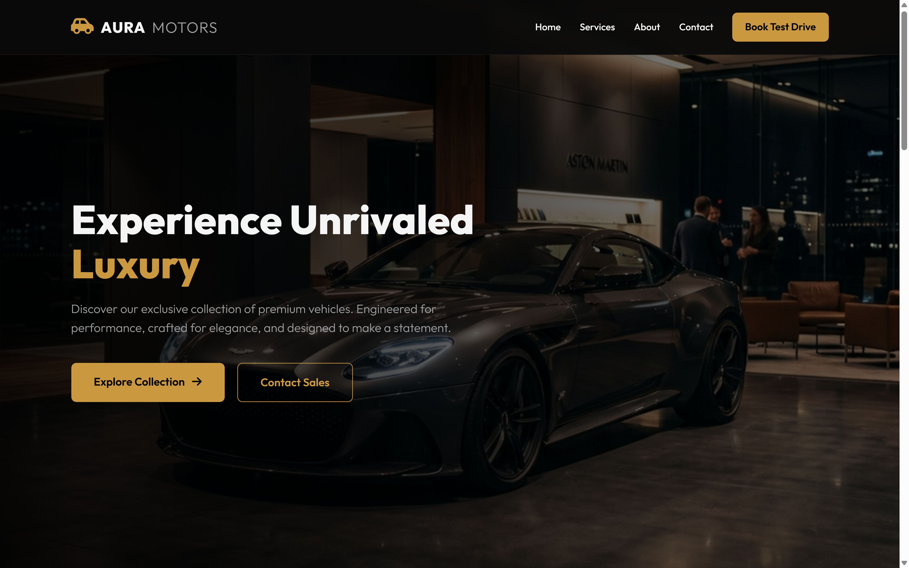
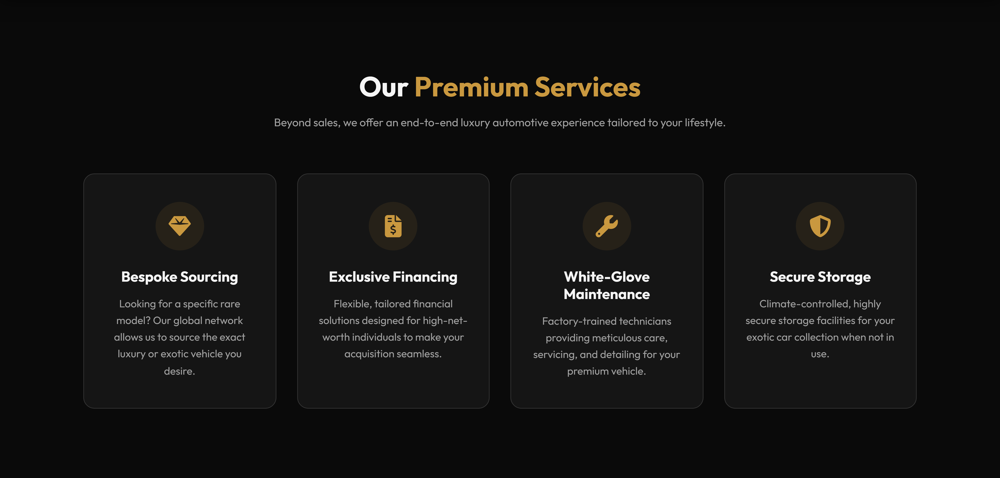
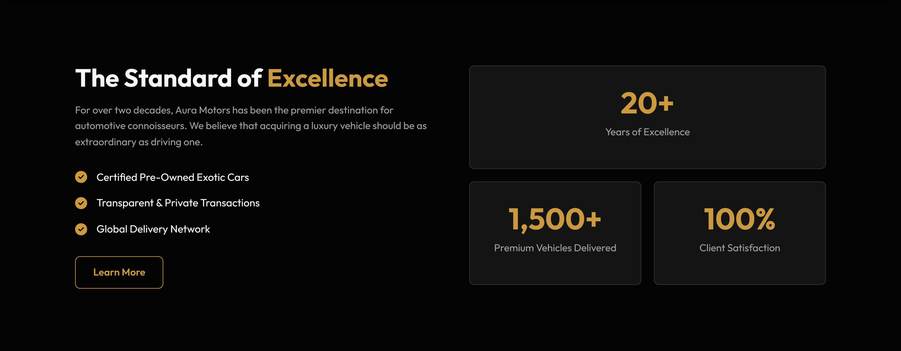
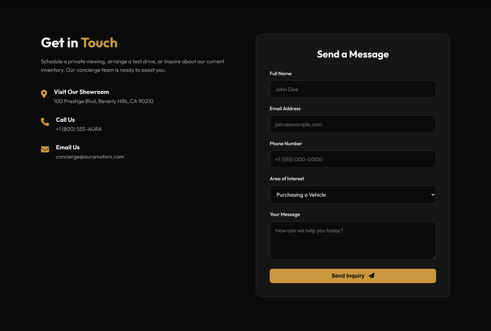
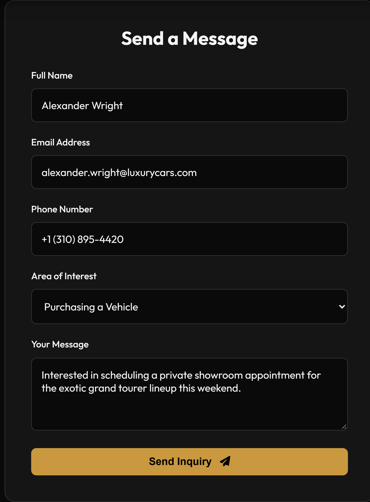
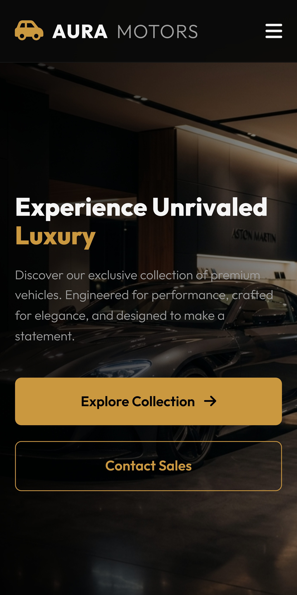
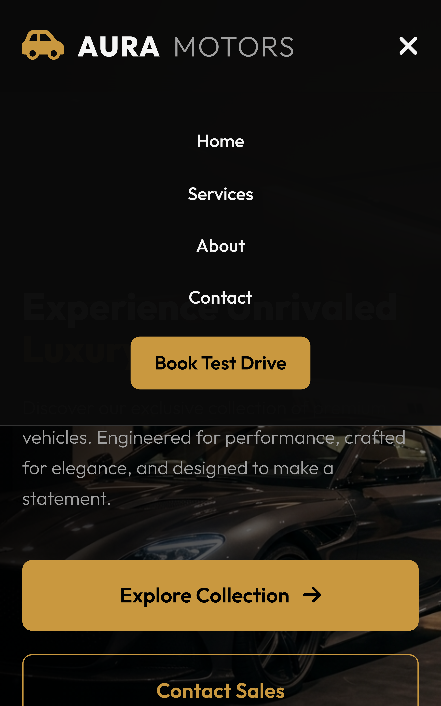

# Task 2: Responsive Business Landing Page - Aura Motors

## Project Overview
This project contains a modern, responsive landing page for "Aura Motors", a fictional premium luxury car dealership. 

## Features Implemented
- **Professional Visual Theme**: A sleek dark mode design with gold (`#c9983f`) accents, matching the premium car dealership aesthetic.
- **Typography**: Uses the 'Outfit' font from Google Fonts for a modern, clean look.
- **Navigation Bar**: Includes brand logo, links to sections, and a prominent CTA button. Sticky behavior and mobile hamburger menu implemented.
- **Hero Section**: High-impact value proposition, clear CTAs, and a generated photorealistic hero image of a sports car in a showroom.
- **Services Section**: A grid layout displaying 4 premium services (Bespoke Sourcing, Exclusive Financing, Maintenance, Storage) using cards and FontAwesome icons.
- **About/Trust Section**: Stats and features to build credibility.
- **Contact Form**: Includes name, email, phone, area of interest dropdown, and message fields with basic HTML validation and mock JS submission.
- **Mobile Responsiveness**: 
  - Layout adapts smoothly below 992px and 768px breakpoints.
  - Navigation converts to a mobile-friendly hamburger menu.
  - Form and buttons are touch-friendly.

## How to View
Simply open `index.html` in any modern web browser. 

## 📸 Screenshots & Showcase

### 🖥️ Desktop Previews

#### **1. Full Landing Page (`index.html`)**

*Full page overview showcasing seamless layout flow, sticky navbar, dark aesthetic, and gold branding accents.*

---

#### **2. Hero Section**

*High-impact hero showcase featuring photorealistic exotic car showroom imagery, headline typography, and dual call-to-action buttons.*

---

#### **3. Premium Services Section**

*Modern 4-column card grid detailing Bespoke Sourcing, Exclusive Financing, White-Glove Maintenance, and Secure Storage.*

---

#### **4. About & Brand Credibility Section**

*Company heritage statement, feature checklist, and key milestone achievement counters (20+ Years, 1,500+ Delivered, 100% Satisfaction).*

---

#### **5. Contact & Concierge Form**

*Dual-column contact layout featuring direct showroom coordinates, contact channels, and a complete inquiry form.*

*Active form inputs with styled dropdown, input focus states, and client-side validation.*

---

### 📱 Responsive & Mobile Views

#### **6. Mobile Full Landing Page View (375x812)**

*Fully responsive fluid layout adapting gracefully to handheld viewports with optimized typography and touch targets.*

---

#### **7. Mobile Hero & Navigation**

*Compact hero presentation on mobile with prominent mobile toggle.*

*Smooth clip-path animated full navigation drawer with fast anchor links and direct CTA button.*

---

#### **8. Tablet View (768x1024 iPad)**

*Adaptive 2-column grid layout transitioning between desktop and mobile formats.*

---

## 👨‍💻 Author Details

- **Author**: **Jigar Pandhare**
- **Role**: Frontend Web Developer
- **Location**: Pune, Maharashtra, India
- **Email**: [jigarpandhare710@gmail.com](mailto:jigarpandhare710@gmail.com)
- **LinkedIn**: [linkedin.com/in/jigar-pandhare-74bb83329](https://www.linkedin.com/in/jigar-pandhare-74bb83329/)
- **GitHub**: [github.com/jigarpandhare25](https://github.com/jigarpandhare25)

---

*Created with ❤️ by Jigar Pandhare for Weintern Assignment-2.*

